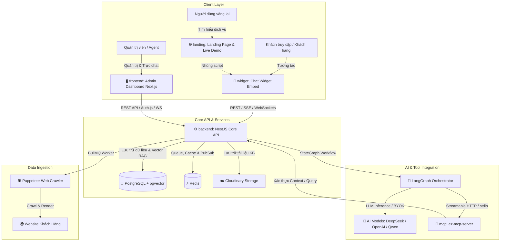

# 🤖 EZ-Chatbot: Enterprise Multi-Tenant AI Chatbot & Conversational Booking Platform

[](LICENSE)
[](./backend)
[](./frontend)
[](./widget)
[](./mcp)
[](./backend)
[](./backend)

**EZ-Chatbot** là nền tảng Chatbot AI đa người dùng (Multi-tenant) hoàn chỉnh dành cho doanh nghiệp, tích hợp hỗ trợ khách hàng thông minh, tư vấn tri thức chuyên sâu (RAG), đặt lịch hẹn trực tiếp trong luồng chat (Conversational Booking) và hỗ trợ giao thức **Model Context Protocol (MCP)** tiêu chuẩn.

---

## 🏛️ Kiến Trúc Tổng Thể (System Architecture)

Hệ thống được thiết kế theo kiến trúc hướng dịch vụ (Service-Oriented Architecture), bao gồm 5 thành phần chính hoạt động phối hợp:



---

## 📦 Danh Mục 5 Thư Mục & Vai Trò (Repository Components)

Hệ thống được tổ chức thành 5 thư mục cốt lõi trong monorepo:

```text
EZ-Chatbot/
├── backend/      # Core API Backend (NestJS, LangGraph, TypeORM, PostgreSQL, WebSockets)
├── frontend/     # Bảng điều khiển quản trị viên & Agent (Next.js 15, Auth.js, Tailwind, Radix)
├── widget/       # Chat widget nhúng website khách hàng (React 19, Vite, Zustand, Shadow DOM)
├── landing/      # Trang giới thiệu sản phẩm & demo trực quan (HTML5, Modern CSS, Vanilla JS)
└── mcp/          # Máy chủ Model Context Protocol (Streamable HTTP / stdio, Standard Tools)
```

---

### 1. `backend/` — Core API & AI Orchestration Service
* **Công nghệ:** NestJS 11, TypeScript, TypeORM, PostgreSQL (hỗ trợ `pgvector`), Redis & BullMQ, LangGraph / LangChain, Socket.IO, Passport JWT.
* **Tính năng chính:**
  * **Xác thực & Phân quyền:** JWT Access/Refresh tokens, cơ chế kích hoạt tài khoản qua email, xác thực 2 bước (2FA TOTP), phân quyền Role-Based Access Control (`SUPER_ADMIN`, `ADMIN`, `AGENT`).
  * **Đa người dùng (Multi-Tenancy):** Cô lập dữ liệu triệt để theo Tổ chức (Organization) và Trang web/Bot (Site).
  * **LangGraph AI Engine:** Điều phối luồng hội thoại dựa trên trạng thái (StateGraph), phân loại ý định (Intent Classification), phát hiện cảm xúc (Sentiment Detection), tóm tắt bộ nhớ ngữ cảnh và hỗ trợ đa ngôn ngữ (VI, EN, JA).
  * **RAG (Retrieval-Augmented Generation):** Xử lý tài liệu (PDF, TXT, DOCX), phân mảnh văn bản (Text Chunking), tính toán vector embedding và truy vấn độ tương đồng cosine qua `pgvector`.
  * **Automated Web Crawler:** Thu thập nội dung tự động qua headless browser (Puppeteer) an toàn với cơ chế phòng vệ chống SSRF (DNS resolution & private IP blocking).
  * **Conversational Booking Engine:** Quản lý dịch vụ, nhân sự/tài nguyên, khung giờ làm việc, tự động khóa chỗ tạm thời (Slot Hold), xác nhận và hủy lịch hẹn qua mã đặt lịch.
  * **Live-Chat & Human Handoff:** Socket.IO Gateway hỗ trợ Agent tiếp quản cuộc trò chuyện (Take Chat), thông báo tin nhắn thời gian thực, typing indicator và cập nhật trạng thái đọc.
  * **BYOK (Bring Your Own Key):** Cho phép doanh nghiệp tự cấu hình API key OpenAI/DeepSeek riêng, được mã hóa đối xứng AES-256-GCM an toàn trong database.

---

### 2. `frontend/` — Admin & Agent Dashboard
* **Công nghệ:** Next.js 15 (App Router), TypeScript, Auth.js (NextAuth v5), Tailwind CSS, Radix UI / Shadcn, Lucide Icons, SWR / Axios.
* **Tính năng chính:**
  * **Quản trị Tổ chức & Trang web:** Tạo và quản lý thông tin các Site/Bot, cấp mã nhúng script tiện lợi.
  * **Tùy biến Giao diện Chatbot (Appearance):** Tùy chỉnh màu chủ đạo (Primary Color), màu nền, biểu tượng launcher, avatar bot, tiêu đề cửa sổ và lời chào tự động.
  * **Cấu hình Trí tuệ Nhân tạo & BYOK:** Chọn model ngôn ngữ (Qwen, GPT-4o...), điều chỉnh system prompt, nhiệt độ sáng tạo, cấu hình API key cá nhân hóa và test kết nối thời gian thực.
  * **Hộp thư Live Agent (Inbox):** Giao diện trực chat thời gian thực cho Agent, xem danh sách hội thoại đang chờ, nhận thông báo đẩy (Audio & Toast notification), tiếp quản cuộc trò chuyện từ AI.
  * **Quản lý Tri thức (Knowledge Base):** Tải lên tài liệu hướng dẫn, kích hoạt crawl website tự động, kiểm tra trạng thái phân tích văn bản.
  * **Quản lý Lịch hẹn (Booking Management):** Bảng lịch trực quan (Calendar view), quản lý khung giờ, tài nguyên, danh sách lịch đặt của khách hàng và thao tác hủy/sửa lịch.
  * **Báo cáo & Phân tích (Analytics):** Thống kê số lượng cuộc hội thoại, tỷ lệ phản hồi hữu ích (Helpful/Unhelpful ratio), thời gian phản hồi trung bình.

---

### 3. `widget/` — Embeddable Visitor Chat & Booking Widget
* **Công nghệ:** React 19, Vite, TypeScript, Zustand (Persistent state), Socket.IO Client, CSS Modules / Shadow DOM.
* **Tính năng chính:**
  * **Kích thước siêu nhẹ & Nhúng đơn giản:** Đóng gói thành file script độc lập (`ez-chat-widget.js`), chỉ cần 1 dòng thẻ `<script data-site-id="...">` là có thể nhúng vào mọi nền tảng (Wordpress, Shopify, Web tĩnh, React, Vue...).
  * **Cách ly Style (Shadow DOM / Iframe):** Đảm bảo CSS của widget không bị ảnh hưởng bởi website chủ và ngược lại.
  * **Luồng đặt lịch trực tiếp (Inline Booking Chips):** Khách hàng chọn dịch vụ, chọn nhân viên/tài nguyên, chọn ngày giờ còn trống ngay trong bong bóng chat mà không cần chuyển trang.
  * **Phát trực tiếp tin nhắn AI (Real-time SSE / WS Streaming):** Hiệu ứng gõ chữ từng token mượt mà tương tự ChatGPT.
  * **Chuyển giao người thật (Human Handoff):** Chuyển đổi trạng thái giao diện rõ ràng khi có tư vấn viên con người tham gia tiếp quản.
  * **Đánh giá phản hồi (Message Feedback):** Nút Like/Dislike trên từng câu trả lời của AI giúp ghi nhận chất lượng phục vụ.

---

### 4. `landing/` — Product Showcase & Live Demo
* **Công nghệ:** HTML5 Semantic, Modern CSS3 (Glassmorphism, CSS Variables, Responsive), Vanilla JavaScript.
* **Tính năng chính:**
  * Giới thiệu tổng quan giải pháp, tính năng nổi bật, bảng giá dịch vụ và các bước tích hợp.
  * **Trải nghiệm thực tế (Live Widget Demo):** Tích hợp sẵn chat widget hoạt động tương tác trực tiếp để khách tham quan trải nghiệm khả năng tư vấn và đặt lịch.
  * Hỗ trợ đa ngôn ngữ giao diện (i18n Tiếng Việt / Tiếng Anh).

---

### 5. `mcp/` — Model Context Protocol Server
* **Công nghệ:** Node.js, TypeScript, Model Context Protocol SDK (`@modelcontextprotocol/sdk`), Axios, Zod.
* **Tính năng chính:**
  * Chuẩn hóa giao tiếp giữa các tác tử AI (AI Agents, Codex CLI, Claude Desktop, v.v.) và backend dữ liệu của EZ-Chatbot theo giao thức chuẩn **Model Context Protocol (MCP)**.
  * **2 Chế độ hoạt động (Transports):**
    * `stdio`: Khởi chạy như một CLI tool/child process cho Codex hoặc các ứng dụng máy trạm.
    * `http`: Mở endpoint `POST /mcp` hỗ trợ Streamable HTTP cho Agent Backend.
  * **Bộ Tools tiêu chuẩn:**
    * `getConversationContext`: Truy xuất ngữ cảnh hội thoại hiện tại.
    * `getUserDetails`: Lấy hồ sơ người dùng trong phạm vi bảo mật của Tenant.
    * `getSiteConfig`: Đọc cấu hình vận hành và chính sách của Site.
    * `searchKnowledge`: Tra cứu tri thức nội bộ từ kho RAG.
    * `getAvailableSlots` / `holdSlot` / `createBooking` / `cancelBooking`: Thực hiện các thao tác kiểm tra và điều phối lịch hẹn.
  * **Bảo mật:** Xác thực inter-service qua header `X-MCP-Secret` và context được ký số HMAC đảm bảo an toàn tuyệt đối cho mô hình đa người thuê.

---

## 🚀 Hướng Dẫn Cài Đặt & Chạy Cục Bộ (Quick Start Guide)

### Yêu cầu tiên quyết
* Node.js v20+ hoặc v24+
* PostgreSQL v15+ (đã cài extension `pgvector`)
* Redis v6+
* Git

---

### 1. Cấu hình biến môi trường
Sao chép các file `.env.example` thành `.env` trong từng thư mục tương ứng:

```bash
# Backend
cp backend/.env.example backend/.env

# Frontend Admin Dashboard
cp frontend/.env.example frontend/.env.local

# Chat Widget
cp widget/.env.example widget/.env

# MCP Server
cp mcp/.env.example mcp/.env
```

---

### 2. Cài đặt Dependencies & Khởi chạy từng dịch vụ

#### Bước 1: Khởi động Backend API (`backend/`)
```bash
cd backend
npm install
npm run migration:run
npm run seed:super-admin
npm run start:dev
```
*API Backend sẽ lắng nghe tại: `http://localhost:3000` (Swagger docs tại `http://localhost:3000/api/v1/docs`)*

#### Bước 2: Khởi động MCP Server (`mcp/`)
```bash
cd mcp
npm install
npm run build
npm start
```
*MCP Server sẽ lắng nghe tại: `http://localhost:3002/mcp`*

#### Bước 3: Khởi động Admin Dashboard (`frontend/`)
```bash
cd frontend
npm install
npm run dev
```
*Bảng điều khiển quản trị mở tại: `http://localhost:3001`*

#### Bước 4: Khởi động Chat Widget (`widget/`)
```bash
cd widget
npm install
npm run dev
```
*Widget dev server mở tại: `http://localhost:5173` (hoặc build ra `dist/ez-chat-widget.js` với `npm run build`)*

#### Bước 5: Mở Landing Page (`landing/`)
```bash
cd landing
# Mở trực tiếp index.html bằng browser hoặc dùng server tĩnh:
npx serve .
```

---

## 🌐 Bảng Cổng & Đường Dẫn Mặc Định (Ports & Endpoints)

| Dịch vụ | Cổng mặc định | Địa chỉ truy cập | Ghi chú |
| :--- | :--- | :--- | :--- |
| **Backend API** | `3000` | `http://localhost:3000` | REST API, Socket.IO, SSE |
| **API Docs (Swagger)** | `3000` | `http://localhost:3000/api/v1/docs` | OpenAPI Specification |
| **Admin Dashboard** | `3001` | `http://localhost:3001` | Quản trị viên & Agent |
| **MCP Server** | `3002` | `http://localhost:3002/mcp` | Model Context Protocol Stream |
| **Chat Widget Dev** | `5173` | `http://localhost:5173` | Dev & Live Preview |
| **Landing Page** | `8000` | `http://localhost:8000` | Giới thiệu & Demo |

---

## 🔒 An Toàn Thông Tin & Bảo Mật (Security & Privacy)

Dự án tuân thủ các nguyên tắc bảo mật khắt khe:
1. **Cô lập Đa Người dùng:** Ràng buộc Tenant ID / Site ID trên mọi câu lệnh truy vấn cơ sở dữ liệu và WebSocket rooms.
2. **Bảo vệ Khóa bí mật (BYOK Encryption):** Khóa API cá nhân của khách hàng được mã hóa đối xứng chuẩn quân đội AES-256-GCM với IV ngẫu nhiên và Auth Tag chống giả mạo.
3. **Phòng chống SSRF:** Trình thu thập crawler và URL validation sử dụng cơ chế phân giải DNS và thư viện kiểm tra IP để chặn hoàn toàn các truy cập tới mạng nội bộ hoặc dải IP máy chủ đám mây.
4. **Kiểm duyệt nội dung (Content Moderation):** Hệ thống lọc nội dung độc hại tự động ngăn chặn spam, tấn công prompt injection hoặc hành vi vi phạm chính sách sử dụng.
5. **Rate Limiting & Throttling:** Áp dụng giới hạn tần suất yêu cầu trên cả REST API và WebSocket kết nối.

---

## 📄 Bản Quyền (License)

Dự án được phân phối dưới giấy phép [MIT License](LICENSE).
Mọi thắc mắc hoặc yêu cầu hỗ trợ, vui lòng tạo Issue trên GitHub repository.
