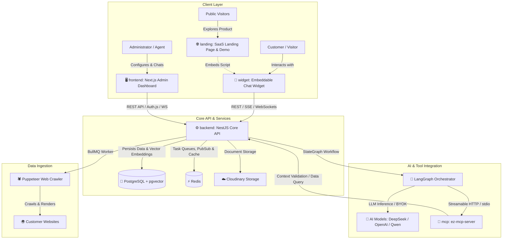

# 🤖 EZ-Chatbot: Enterprise Multi-Tenant AI Chatbot & Conversational Booking Platform

[](LICENSE)
[](./backend)
[](./frontend)
[](./widget)
[](./mcp)
[](./backend)
[](./backend)

**EZ-Chatbot** is an enterprise-grade, multi-tenant AI conversational platform designed to deliver intelligent customer support, deep knowledge retrieval (RAG), conversational appointment booking, and seamless agent handoff—powered by **LangGraph** and standardized with the **Model Context Protocol (MCP)**.

---

## 🏛️ System Architecture

The platform follows a Service-Oriented Architecture (SOA) structured into 5 cohesive components:



---

## 📦 Repository Structure & Services

The monorepo contains 5 dedicated service folders:

```text
EZ-Chatbot/
├── backend/      # Core REST & WebSocket API, LangGraph Orchestration, RAG, TypeORM
├── frontend/     # Multi-tenant Admin & Agent Dashboard (Next.js 15, Auth.js, Tailwind, Radix)
├── widget/       # Embeddable Chat & Booking Widget (React 19, Vite, Zustand, Shadow DOM)
├── landing/      # High-converting SaaS Marketing Website with Live Interactive Demo
└── mcp/          # Standalone Model Context Protocol Server (Streamable HTTP / stdio)
```

---

### 1. `backend/` — Core API & AI Orchestration Service
* **Tech Stack:** NestJS 11, TypeScript, TypeORM, PostgreSQL (`pgvector`), Redis & BullMQ, LangGraph / LangChain, Socket.IO, Passport JWT.
* **Core Capabilities:**
  * **Authentication & Authorization:** JWT Access/Refresh tokens, email account activation, TOTP-based Two-Factor Authentication (2FA), and Role-Based Access Control (`SUPER_ADMIN`, `ADMIN`, `AGENT`).
  * **Strict Multi-Tenancy:** Organizational scoping and site-level isolation applied across all database operations, queues, and WebSocket rooms.
  * **LangGraph AI Orchestration:** StateGraph conversational workflow managing intent classification, sentiment analysis, memory summarization, out-of-scope filtering, and multilingual support (EN, VI, JA).
  * **RAG (Retrieval-Augmented Generation):** Automated document ingestion (PDF, TXT, DOCX), semantic chunking, embedding generation, and cosine similarity vector search via `pgvector`.
  * **Hardened Web Crawler:** Headless browser automation (Puppeteer) with built-in SSRF defense (DNS resolution checks and private network blocking via `ipaddr.js`).
  * **Conversational Booking Engine:** Slot calculation, service & resource allocation, conflict prevention, atomic hold slots, confirmation, and self-service cancellation.
  * **Live Agent Handoff & Real-time Chat:** Socket.IO gateway facilitating agent takeover ("Take Chat"), real-time message broadcasting, typing indicators, and delivery receipts.
  * **Bring Your Own Key (BYOK):** Tenants can configure custom OpenAI / DeepSeek credentials, stored encrypted with authenticated AES-256-GCM.

---

### 2. `frontend/` — Admin & Live Agent Dashboard
* **Tech Stack:** Next.js 15 (App Router), TypeScript, Auth.js (NextAuth v5), Tailwind CSS, Radix UI / Shadcn, Lucide Icons, SWR.
* **Core Capabilities:**
  * **Organization & Site Management:** Multi-bot provisioning, domain allowlist configuration, and 1-click script generator.
  * **Branding & Appearance Customizer:** Live preview of custom brand color schemes, background colors, custom bot avatars, launcher icons, and welcome greetings.
  * **AI Personality & BYOK Configuration:** Model selector (Qwen, GPT-4o, etc.), custom system prompts, temperature tuning, and on-demand connection testing.
  * **Live Agent Inbox:** Real-time conversational console with audio/toast alerts, message queues, conversation history preview, and AI-to-Human handoff controls.
  * **Knowledge Base Center:** Manual document file upload, on-demand web crawler triggers, and chunk indexing status tracking.
  * **Booking & Calendar Management:** Visual appointment schedule, resource and service allocation, blackout periods, and manual booking overrides.
  * **Analytics & Performance Metrics:** Total conversations, sentiment breakdown, helpful/unhelpful feedback ratios, and average response times.

---

### 3. `widget/` — Embeddable Visitor Chat & Booking Widget
* **Tech Stack:** React 19, Vite, TypeScript, Zustand (Persistent storage), Socket.IO Client, Shadow DOM isolation.
* **Core Capabilities:**
  * **Zero-Friction Script Embedding:** Bundled into a standalone, ultra-lightweight JavaScript bundle (`ez-chat-widget.js`) injected via a single `<script>` tag.
  * **Shadow DOM Style Isolation:** Encapsulates styles so the host website's CSS never bleeds into the widget and vice versa.
  * **Interactive Booking Chips:** Inline appointment flow allowing visitors to select services, choose staff members, pick open slots, and confirm appointments without leaving the chat.
  * **Real-Time Token Streaming:** Low-latency token-by-token streaming (SSE and WebSockets) delivering ChatGPT-like responsiveness.
  * **Agent Handoff Indicator:** Smooth UI state transitions when conversations switch from AI to human agents.
  * **Customer Feedback:** Thumbs-up / thumbs-down buttons on AI responses to continuously measure and improve answer quality.

---

### 4. `landing/` — SaaS Marketing & Interactive Demo
* **Tech Stack:** Semantic HTML5, Modern CSS3 (Glassmorphism, CSS Custom Properties, Responsive Layouts), Vanilla JavaScript.
* **Core Capabilities:**
  * Comprehensive feature showcase, transparent pricing tiers, and integration tutorials.
  * **Interactive Live Demo:** Features an embedded, functioning chat widget allowing prospective clients to experience conversational AI and appointment booking in real time.
  * Multilingual presentation with localized content (English / Vietnamese).

---

### 5. `mcp/` — Model Context Protocol Server
* **Tech Stack:** Node.js, TypeScript, Model Context Protocol SDK (`@modelcontextprotocol/sdk`), Axios, Zod.
* **Core Capabilities:**
  * Standardizes communication between autonomous AI agents (Codex CLI, Claude Desktop, Cursor, etc.) and the EZ-Chatbot backend ecosystem.
  * **Dual Transports:**
    * `stdio`: Direct standard I/O transport for local CLI execution and local desktop agents.
    * `http`: Exposes a Streamable HTTP endpoint at `POST /mcp` for the LangGraph backend agent.
  * **Standardized Tools:**
    * `getConversationContext`: Fetches current session history and metadata.
    * `getUserDetails`: Retrieves tenant-scoped visitor profile information safely.
    * `getSiteConfig`: Reads operational hours, policies, and booking settings.
    * `searchKnowledge`: Queries the site's vectorized knowledge base.
    * `getAvailableSlots` / `holdSlot` / `createBooking` / `cancelBooking`: Coordinates booking transactions safely.
  * **Inter-Service Security:** Protected via `X-MCP-Secret` headers and HMAC-signed context payloads ensuring multi-tenant isolation.

---

## 🚀 Quick Start Guide

### Prerequisites
* **Node.js**: v20.x or v24.x LTS
* **PostgreSQL**: v15+ with the `pgvector` extension enabled
* **Redis**: v6+
* **Git**

---

### 1. Environment Configuration

Copy the example environment files across all service folders:

```bash
# Backend API
cp backend/.env.example backend/.env

# Frontend Admin Dashboard
cp frontend/.env.example frontend/.env.local

# Chat Widget
cp widget/.env.example widget/.env

# MCP Server
cp mcp/.env.example mcp/.env
```

---

### 2. Service Installation & Execution

#### Step 1: Start Backend API (`backend/`)
```bash
cd backend
npm install
npm run migration:run
npm run seed:super-admin
npm run start:dev
```
*Backend API will run at `http://localhost:3000` (Swagger docs available at `http://localhost:3000/api/v1/docs`)*

#### Step 2: Start MCP Server (`mcp/`)
```bash
cd mcp
npm install
npm run build
npm start
```
*MCP Server endpoint will be available at `http://localhost:3002/mcp`*

#### Step 3: Start Admin Dashboard (`frontend/`)
```bash
cd frontend
npm install
npm run dev
```
*Admin Dashboard will run at `http://localhost:3001`*

#### Step 4: Start Chat Widget (`widget/`)
```bash
cd widget
npm install
npm run dev
```
*Widget dev server runs at `http://localhost:5173` (or compile for production via `npm run build`)*

#### Step 5: Serve Landing Page (`landing/`)
```bash
cd landing
# Open index.html directly or serve using any static web server:
npx serve .
```

---

## 🌐 Default Ports & Endpoints

| Service | Port | Endpoint URL | Description |
| :--- | :--- | :--- | :--- |
| **Backend API** | `3000` | `http://localhost:3000` | REST API, Socket.IO, SSE |
| **Swagger Documentation** | `3000` | `http://localhost:3000/api/v1/docs` | OpenAPI 3.0 Interactive Docs |
| **Admin Dashboard** | `3001` | `http://localhost:3001` | Multi-Tenant Management Portal |
| **MCP Server** | `3002` | `http://localhost:3002/mcp` | Streamable HTTP Model Context Protocol |
| **Chat Widget Dev Server** | `5173` | `http://localhost:5173` | Local Widget Testing & Preview |
| **SaaS Landing Page** | `8000` | `http://localhost:8000` | Marketing Website & Demo |

---

## 🔒 Security & Privacy Engineering

EZ-Chatbot enforces defence-in-depth principles:
1. **Multi-Tenant Scoping:** All database queries, vector similarity searches, and WebSocket broadcasts strictly enforce Organization and Site ownership checks.
2. **BYOK Secret Encryption:** Customer-provided AI provider API keys are encrypted using AES-256-GCM with distinct IVs and authentication tags.
3. **SSRF Defense:** Web crawling engines resolve DNS hostnames prior to connection, explicitly dropping private IPv4/IPv6 ranges and cloud metadata IPs (`169.254.169.254`).
4. **Content Moderation:** Automated moderation filters check inbound user queries to detect prompt injection, abuse, and inappropriate content.
5. **Rate Limiting:** Granular throttling guards against brute force and DDoS attempts across HTTP endpoints and WebSocket connections.

---

## 📄 License

This project is licensed under the [MIT License](LICENSE).
For inquiries, bug reports, or enterprise support, please open an issue in this repository.
