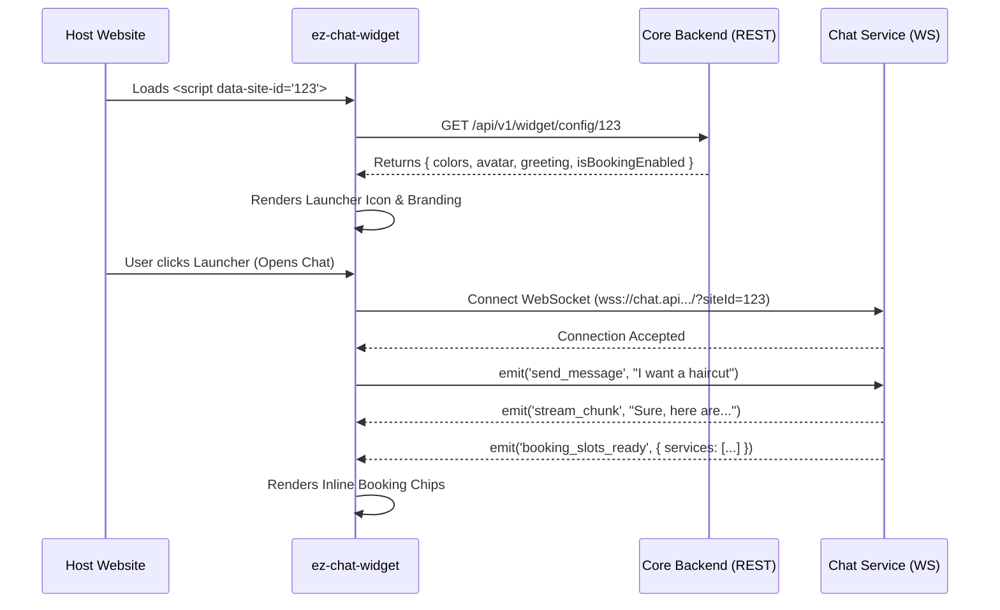

# ez-chat-widget

> The official visitor-facing, embeddable Chat & Booking Widget for the **ez-chat-bot** ecosystem.

## 📖 Overview

`ez-chat-widget` is a lightweight, high-performance frontend application designed to be embedded directly into our tenants' (customers') websites. It serves as the primary touchpoint for end-users (visitors) to interact with the AI assistant, search the Knowledge Base, and book appointments directly through a conversational interface.

This repository generates a single, bundled JavaScript file (`widget.js`) that is injected into any authorized website via a simple `<script>` tag.

## ✨ Key Features (Based on PRD)

- **Dynamic Branding (WID-003):** Automatically applies the tenant's configured primary color, background color, avatar, launcher icon, and greeting message.
- **Conversational Booking (WID-016 - WID-018):**
  - Entire booking flow is handled _inline_ within the chat stream using interactive "Chips".
  - Displays Services, Staff (Resources), and Available Time Slots directly in the chat bubbles.
  - Finalizes bookings with a unified Summary Card.
- **Real-Time AI Streaming:** Uses WebSockets to stream LLM responses token-by-token (similar to ChatGPT) for a snappy user experience.
- **Human Agent Handoff (WID-013):** Seamlessly transitions from AI to a Human Agent, including UI state changes (e.g., "Chatting with Admin").
- **Message Feedback (WID-011):** Includes intuitive thumbs-up / thumbs-down buttons on AI responses to measure _Helpful-Response Ratio_.
- **Shadow DOM Isolation:** Renders inside a Shadow DOM or iframe to ensure the widget's CSS does not conflict with the host website's styles.

## 🏗️ Architecture & Data Flow

This widget interacts with two distinct backend services in the `ez-chat-bot` ecosystem:

1. **Core Backend (REST API):** Used only at initialization to fetch the widget's appearance configuration.
2. **Chat Service (WebSocket Gateway):** Used for the entire duration of the chat session to send intents, receive AI text streams, and fetch booking slots.



## 🚀 Development Setup

### Prerequisites

- Node.js (v18+)
- npm or yarn

### Installation

```bash
# Clone the repository
git clone https://github.com/your-org/ez-chat-widget.git
cd ez-chat-widget

# Install dependencies
npm install

# Start local development server (with a mock host page)
npm run dev
```

### Environment Variables (`.env`)

```env
VITE_CORE_API_URL=http://localhost:3000/api/v1
VITE_CHAT_WS_URL=ws://localhost:3001/socket
```

### Build for Production

```bash
npm run build
```

_This command bundles the application into a single `dist/widget.js` file optimized for CDN delivery._

## 💻 Embedding the Widget (Usage)

To install the widget on a customer's website, the Admin will copy and paste the following snippet just before the closing `</body>` tag of their HTML:

```html
<!-- ez-chat-bot Widget -->
<script
  src="https://cdn.ezchatbot.com/widget.js"
  data-site-id="YOUR_UNIQUE_SITE_ID"
  data-backend-url="https://api.ezchatbot.com"
  data-page-context="true"
  defer
></script>
```

- `src`: Points to the CDN hosting the bundled file from this repository.
- `data-site-id`: The unique Tenant ID generated by the Core Backend when the Admin creates a Site.
- `data-page-context`: Optional local opt-out. Page context is collected only when the Site's `Use Current Page Content` setting is enabled; set this attribute to `false` to disable collection for this embed as well.
- Backend URL is read from `VITE_BACKEND_URL` at build time and bundled into the widget.

The widget reads only sanitized text from the current page. Add
`data-ez-chat-ignore` to any host-page section that must never be included:

```html
<section data-ez-chat-ignore>Private account information</section>
```

## 🔌 WebSocket Events Contract (Draft)

When communicating with the `chat-service` repo, the widget uses the following primary events:

| Event Name            | Direction   | Payload Example                           | Description                               |
| --------------------- | ----------- | ----------------------------------------- | ----------------------------------------- |
| `send_message`        | Widget ➔ WS | `{ text: "Hi" }`                          | User sends a text message.                |
| `select_booking_slot` | Widget ➔ WS | `{ slotId, date }`                        | User taps an inline time slot chip.       |
| `stream_chunk`        | WS ➔ Widget | `{ chunk: "Hello " }`                     | AI typing response in real-time.          |
| `booking_intent`      | WS ➔ Widget | `{ step: "select_service", data: [...] }` | Instructs widget to render service chips. |
| `agent_joined`        | WS ➔ Widget | `{ agentName: "Lan" }`                    | Updates UI to show a human took over.     |

---

_Maintained by the ez-chat-bot Frontend Team._

# React + TypeScript + Vite

This template provides a minimal setup to get React working in Vite with HMR and some ESLint rules.

Currently, two official plugins are available:

- [@vitejs/plugin-react](https://github.com/vitejs/vite-plugin-react/blob/main/packages/plugin-react) uses [Oxc](https://oxc.rs)
- [@vitejs/plugin-react-swc](https://github.com/vitejs/vite-plugin-react/blob/main/packages/plugin-react-swc) uses [SWC](https://swc.rs/)

## React Compiler

The React Compiler is not enabled on this template because of its impact on dev & build performances. To add it, see [this documentation](https://react.dev/learn/react-compiler/installation).

## Expanding the ESLint configuration

If you are developing a production application, we recommend updating the configuration to enable type-aware lint rules:

```js
export default defineConfig([
  globalIgnores(["dist"]),
  {
    files: ["**/*.{ts,tsx}"],
    extends: [
      // Other configs...

      // Remove tseslint.configs.recommended and replace with this
      tseslint.configs.recommendedTypeChecked,
      // Alternatively, use this for stricter rules
      tseslint.configs.strictTypeChecked,
      // Optionally, add this for stylistic rules
      tseslint.configs.stylisticTypeChecked,

      // Other configs...
    ],
    languageOptions: {
      parserOptions: {
        project: ["./tsconfig.node.json", "./tsconfig.app.json"],
        tsconfigRootDir: import.meta.dirname,
      },
      // other options...
    },
  },
]);
```

You can also install [eslint-plugin-react-x](https://github.com/Rel1cx/eslint-react/tree/main/packages/plugins/eslint-plugin-react-x) and [eslint-plugin-react-dom](https://github.com/Rel1cx/eslint-react/tree/main/packages/plugins/eslint-plugin-react-dom) for React-specific lint rules:

```js
// eslint.config.js
import reactX from "eslint-plugin-react-x";
import reactDom from "eslint-plugin-react-dom";

export default defineConfig([
  globalIgnores(["dist"]),
  {
    files: ["**/*.{ts,tsx}"],
    extends: [
      // Other configs...
      // Enable lint rules for React
      reactX.configs["recommended-typescript"],
      // Enable lint rules for React DOM
      reactDom.configs.recommended,
    ],
    languageOptions: {
      parserOptions: {
        project: ["./tsconfig.node.json", "./tsconfig.app.json"],
        tsconfigRootDir: import.meta.dirname,
      },
      // other options...
    },
  },
]);
```
